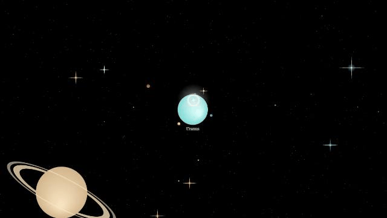

# Vesper

A one-page flight through a deep star field. Vesper is the ship at the center of the glass. The stars rush toward you, and the Sun, the planets, the Moon, a comet, and the asteroids Ceres and Vesta drift in the dive.

Hold a steady hand and the dive speeds up, up to a fixed top speed. Empty space does not break the sky. Flying into a world does: the glass shatters, the bright stars take new places, and another field opens.

## Run it

Open `index.html` in a browser. No build step and no install.

The page is plain HTML, CSS, and JavaScript (`index.html`, `style.css`, `script.js`).

## Fly

- **Drag** across the glass, then release. Vesper turns that way and keeps the new course.
- **Tap** (a short press) to level out and dive straight ahead.
- **Hold still** to build speed. The dive tops out on its own.
- **Move quickly** and the dive slows.
- Bring the Sun, a planet, the Moon, the comet, or an asteroid into the nose to strike it.

The ship name sits at the top left. Warnings at the top right follow the dive: turning, closing on a world, flank speed, or a broken glass.

## Worlds

Sun, Mercury, Venus, Earth, the Moon, Mars, Jupiter, Saturn, Uranus, Neptune, a comet, Ceres, and Vesta.
